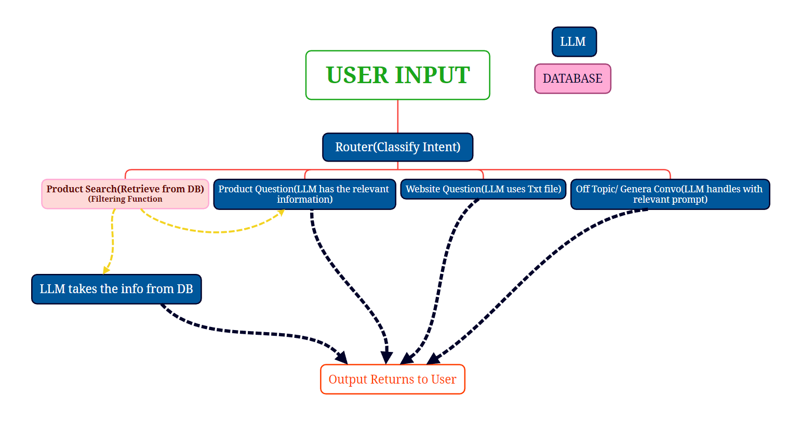

# Design & Data Processing

How the Fashion Assistant is built and why. For setup and running see the [README](../README.md).

## 1. Problem
Shoppers ask free-form questions ("blue slim-fit shirt for men", "what is your refund policy?").
A plain LLM would invent products and policies, so answers must be **grounded** in the store's own
catalogue and policy text.

## 2. Architecture

| Component | Where | Responsibility |
|-----------|-------|----------------|
| Streamlit UI | `app/streamlit_app.py` | Chat interface only; no business logic |
| Assistant | `src/fashion_rag/assistant.py` | Intent routing, retrieval, prompt building, memory |
| Config | `src/fashion_rag/config.py` | The single place env vars and paths are read |
| Clients | `src/fashion_rag/clients.py` | The single place OpenAI / Weaviate clients are built |
| Processing | `src/fashion_rag/processing.py`, `data.py` | Pure data transformations and JSON-lines I/O |
| Vector DB | Weaviate (`docker-compose.yml`) | Stores products, embeds with `text-embedding-3-small` |

### Request flow
1. `classify_intent` asks the LLM (low temperature, 20 tokens) for one of
   `product_search`, `product_question`, `website_question`, `other`.
2. The router dispatches:
   - **product_search** → category/sub-category filters are extracted from the query using the
     values present in the dataset, then Weaviate **hybrid search** (BM25 + vector) runs with those
     filters and a distance cut-off; the LLM formats the hits.
   - **product_question** → retrieval-augmented answer limited to retrieved products.
   - **website_question** → answered from `data/Fashionista_Website_Info.txt` only.
   - **other** → short, polite small-talk reply.
3. The last few turns are passed back as context (short-term memory).

### Design decisions
- **Dependency injection for clients.** `FashionAssistant` accepts clients as arguments, so the
  tests run offline with fakes (no API key, no network).
- **One config module.** No `os.getenv` or client construction scattered through the code.
- **Hybrid search** because product queries mix exact terms (colour, fabric) and fuzzy intent.
- **Docker Compose for the whole stack** so the app resolves Weaviate by service name and anyone can
  run it with one command.
- **Datasets stay out of git.** The full data is large; a 60-product sample is committed and used as
  an automatic fallback so a fresh clone still runs.

## 3. Data
Source: Flipkart fashion products dataset (see [notebooks/README.md](../notebooks/README.md) for the
download link — *placeholder, to be added*).

### Processing stages
| Stage | Artifact | Produced by |
|-------|----------|-------------|
| Raw | `notebooks/flipkart_fashion_products_dataset.json` | download |
| Cleaned & feature-engineered | `preprocessed_data.json` | `notebooks/data_analysis.ipynb` |
| Availability filter | `data_ready.json` | notebook |
| Class-balanced subset (854 products) | `data/balanced_data.json` | notebook |
| Flattened `product_details` | `data/modified_balanced_data.json` | `scripts/process_data.py` |
| Embedded + indexed | Weaviate `Product` class | `scripts/create_schema.py`, `scripts/ingest_data.py` |

Why the last cleaning step lives in `scripts/` and not the notebook: it is deterministic, tested
(`tests/test_processing.py`), and must run in the app's pipeline.

## 4. Data analysis report
> **Placeholder.** Summary of findings from `notebooks/data_analysis.ipynb` (missing values, category
> distribution, why and how the dataset was balanced, feature-engineering choices) goes here, plus a
> link to the full report.

## 5. Testing & quality
- `pytest` unit tests with fake OpenAI/Weaviate clients (`tests/conftest.py`).
- `ruff` lint; both run in GitHub Actions on every push (`.github/workflows/ci.yml`).

## 6. Known limitations / next steps
- Filter extraction is substring matching on known category names; an LLM or embedding-based
  extractor would handle synonyms.
- Uses `weaviate-client` v3 API; migrating to v4 is a future task.
- No evaluation set yet for retrieval quality (precision@k) or answer faithfulness.
